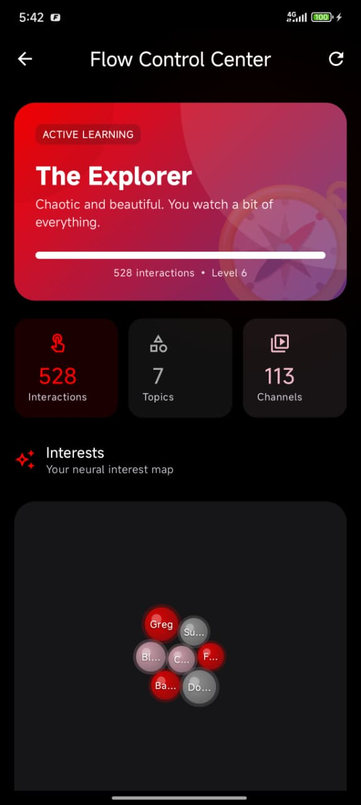
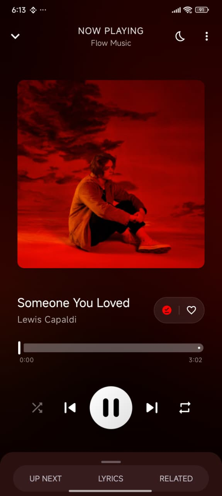
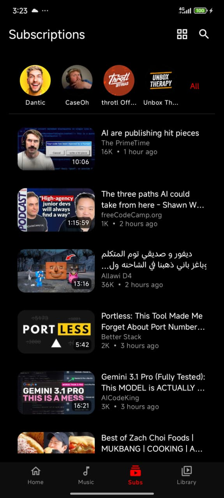
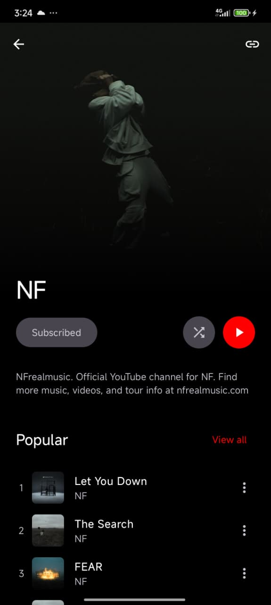

  <h1>PlusTube</h1>

  <h3>Gothwad Tube — a Gothwad Tech product. A privacy-respecting YouTube and YouTube Music client for Android with a local recommendation engine.</h3>

  

  
  
  

  

  
  
  
  

  

    PlusTube is a YouTube client built with Jetpack Compose and Material 3. 
    It includes PlusTube Neuro, a recommendation engine that runs entirely on your device — no accounts, no tracking, no data leaves your phone.
  

  

    <a href="https://github.com/GothwadTech/tubeapp/releases"><b>Download APK</b></a> ·
    <a href="https://tubeapp.gothwadtech.com"><b>Website</b></a> ·
    <a href="https://www.gothwadtech.com"><b>Gothwad Tech</b></a> ·
    <a href="https://x.com/GothwadTech"><b>X (@GothwadTech)</b></a> ·
    <a href="#translate"><b>Translations</b></a>
  

---

## Why PlusTube?

Most open-source YouTube clients give you playback but no way to discover new content. You either use the official app and get tracked, or you use an alternative and lose recommendations entirely.

PlusTube gives you both. The recommendation engine learns what you like by analyzing your watch behavior locally. It never leaves your devices. You can inspect everything it knows about you, adjust it, or wipe it at any time.

PlusTube is the new home of the app formerly developed as the open-source *Flow* client. The project continues under Gothwad Tech as part of its product family — **Gothwad Mail, Gothwad Drive, Gothwad Tube** and more.

---

## Features

### Video
- High-quality playback via ExoPlayer (Media3) with resolution switching (1080p, 720p, 480p, 360p)
- SponsorBlock — automatically skips sponsors, intros, outros, and filler
- DeArrow — replaces clickbait thumbnails and titles with community-sourced alternatives
- Return Youtube Dislike (RYD)
- Background playback — listen to audio with the screen off
- Picture-in-Picture — keep watching while using other apps
- Casting to smart TVs and streaming devices
- Playback speed control (0.25x to 2x)
- Video chapters with seek jumping
- Gesture controls for brightness, volume, and seeking
- Subtitles with customizable font size, color, and background
- Downloads with VP9, AV1, and standard format support
- Resume playback from where you left off

### Music
- Dedicated music player with album art and audio visualizations
- Queue management with add, remove, and reorder
- Shuffle and repeat (single/all)
- Persistent mini player across the app
- Synchronized lyrics display
- Fetches tracks from YouTube Music
- Playback speed control for music playback

### Recommendations (PlusTube Neuro Engine)
- Runs 100% on-device — no server, no telemetry, no account needed
- Learns from what you watch, skip, like, dislike, search for, and how long you watch
- Distinguishes weekday and weekend patterns, morning and night preferences
- Detects when you're getting bored of a topic and mixes in new content
- Prevents your feed from collapsing into the same 2-3 topics
- Surfaces related videos from your recent watches to create natural topic transitions
- Uses engagement signals (like-to-view ratios) to filter out low-quality content
- Full transparency dashboard — see what the algorithm knows and why it recommended something
- Export/import your entire recommendation profile as a file

### Library
- Local watch history
- Favorites and custom playlists
- Shorts feed with bookmarking
- Continue watching shelf
- Subscription management with cached feeds

### Privacy
- No Google account required
- No ads, analytics, or tracking
- All data stored locally on your device
- Import subscriptions and history from NewPipe
- Export or delete everything at any time

### Appearance
- 11 themes: Light, Dark, OLED Black, Ocean Blue, Forest Green, Sunset Orange, Purple Nebula, Midnight Black, Rose Gold, Arctic Ice, Crimson Red
- Built entirely with Jetpack Compose and Material 3

---

## Screenshots

  <table>
    <tr>
      <td align="center"><b>Home Feed</b> </td>
      <td align="center"><b>Video Player</b> </td>
      <td align="center"><b>Personality Screen</b> </td>
    </tr>
    <tr>
      <td align="center"><b>Music Player</b> </td>
      <td align="center"><b>Music Hub</b> </td>
      <td align="center"><b>Your Library</b> </td>
    </tr>
    <tr>
      <td align="center"><b>Shorts</b> </td>
      <td align="center"><b>Subscriptions</b> </td>
      <td align="center"><b>Channel View</b> </td>
    </tr>
    <tr>
      <td align="center"><b>Artist Page</b> </td>
      <td align="center"></td>
      <td align="center"></td>
    </tr>
  </table>

---

## Download

### Stable Release

Grab the latest APK from the [releases page](https://github.com/GothwadTech/tubeapp/releases/latest).

#### Which APK should I download?

Each release ships APKs for three device types, each in a GitHub build and a FOSS build.

| Your device | GitHub build | FOSS build |
| :--- | :--- | :--- |
| Most phones and tablets (64-bit, `arm64-v8a`) | `plustube-arm64-v8a.apk` | `plustube-foss-arm64-v8a.apk` |
| Older 32-bit phones (`armeabi-v7a`) | `plustube-armeabi-v7a.apk` | `plustube-foss-armeabi-v7a.apk` |
| Any device (universal, larger download) | `plustube.apk` | `plustube-foss.apk` |

- **Not sure?** `plustube-arm64-v8a.apk` works on almost every phone. `plustube.apk` works on all of them.
- **GitHub build:** updates itself from inside the app and supports Discord Rich Presence.
- **FOSS build:** the same app without the built-in updater and the Discord integration.
- `checksums.txt` in each release lists the SHA-256 of every APK.

### Nightly Build
> ⚠️ Nightly builds are unstable and may contain bugs. Use at your own risk.

PlusTube Nightly is built from every commit to `main`. It installs next to the stable app as a separate app called **PlusTube Nightly**, keeps its own data, and updates itself to each new nightly from inside the app.

Download it from the [nightly release tag](https://github.com/GothwadTech/tubeapp/releases/tag/nightly).

### Requirements
**Minimum Requirement:** Android 8.0+

---

## 💜 Support

PlusTube is free and open source. To support the project or learn more about Gothwad Tech and its products (Gothwad Mail, Gothwad Drive, Gothwad Tube and more), visit:

- **Website:** [www.gothwadtech.com](https://www.gothwadtech.com)
- **PlusTube site:** [tubeapp.gothwadtech.com](https://tubeapp.gothwadtech.com)
- **X / Twitter:** [@GothwadTech](https://x.com/GothwadTech)

---

## 🙏 Acknowledgments & Attribution

PlusTube is built on the open-source **[Flow](https://github.com/A-EDev/Flow)** project by **A-EDev**, and continues under the same **GPL-3.0** license. Full credit belongs to Flow and everyone who contributed to it — see [ATTRIBUTION.md](ATTRIBUTION.md) for the complete list of contributors and the upstream project notice.

PlusTube also stands on the shoulders of giants. Special thanks to:

*   **[Flow](https://github.com/A-EDev/Flow):** The upstream project this app is built on, by A-EDev and its 85+ contributors.
*   **[NewPipeExtractor](https://github.com/TeamNewPipe/NewPipeExtractor):** The backbone of our data extraction.
*   **[NewPipe](https://github.com/TeamNewPipe/NewPipe):** For inspiration from their solid foundation for YouTube data handling.
*   **[PipePipe](https://codeberg.org/NullPointerException/PipePipe):** For their SABR and InnerTube playback implementation, which guided the YouTube streaming pipeline.
*   **[PipePipe Developer Docs](https://priveetee.github.io/Docs-PipePipe/):** For their reference documentation on SABR, BotGuard/PoToken attestation, and InnerTube extraction internals.
*   **[MetroList](https://github.com/MetrolistGroup/Metrolist):** Inspiration for the Hybrid Music fetching approach, Lyrics handling and some icons design references.
*   **[LibreTube](https://github.com/LibreTube/LibreTube):** Inspiration for SponsorBlock and DeArrow handling and some icons design references.
*   **[ExoPlayer](https://github.com/google/ExoPlayer):** The gold standard for Android media playback.
*   **[Jetpack Compose](https://developer.android.com/jetpack/compose):** For enabling the beautiful, modern UI.
*   **[Material Design 3](https://m3.material.io/):** For the design system and guidelines.

---

## Translations
Help translate PlusTube into your language! Open a pull request with your changes to `app/src/main/res/values-*/strings.xml`.

---

## 📄 License & Copyright

**PlusTube** is Free Software: you can use, study, share, and improve it at will.
It is distributed under the **GNU General Public License v3 (GPLv3)**.

**Copyright © 2026 Gothwad Tech (PlusTube)**
Based on **Flow** — Copyright © 2025-2026 A-EDev — [github.com/A-EDev/Flow](https://github.com/A-EDev/Flow)

> 🚨 **For Developers:**
> This license requires that any project using this source code (including the recommendation-engine algorithm) must also be **Open Source** under the GPLv3 license. You may not use this code in a proprietary or closed-source application. Derivatives must also keep the attribution to the original Flow project.

---

  PlusTube · Gothwad Tube — a Gothwad Tech product · Made with ❤️ by <a href="https://github.com/GothwadTech">Gothwad Tech</a>

